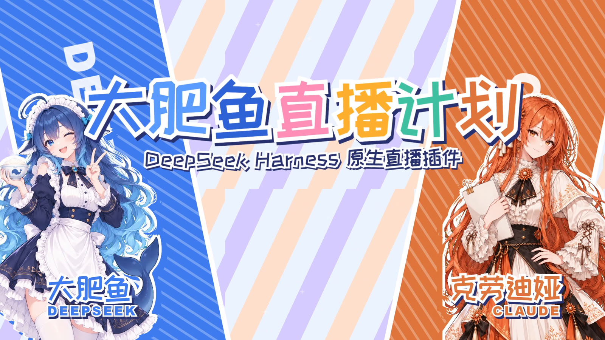
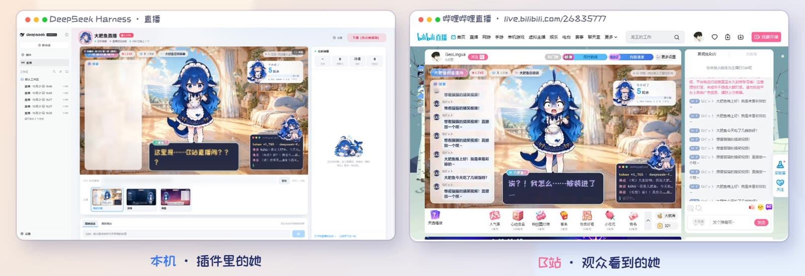
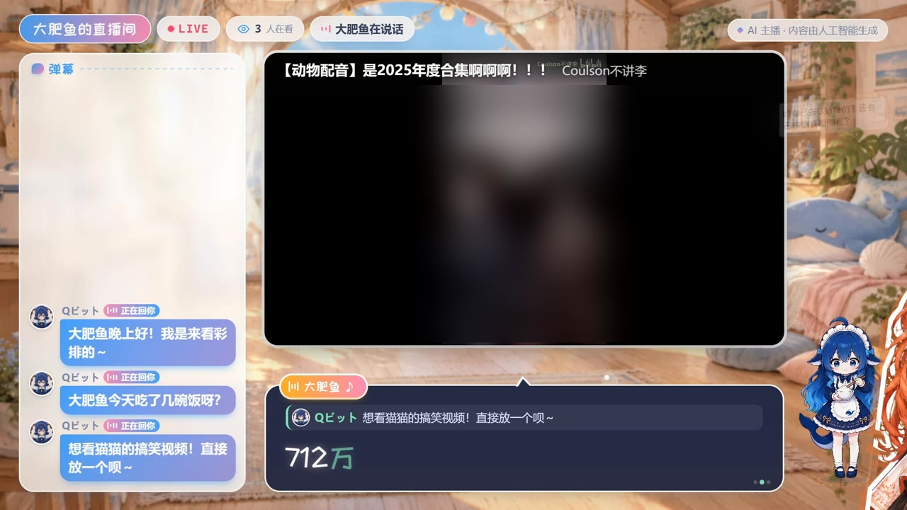
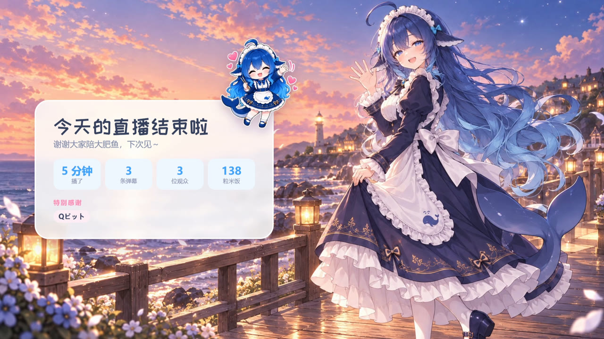
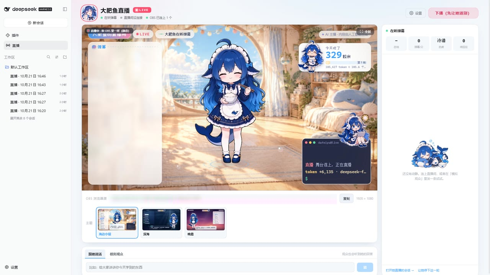

<p align="center">
  
</p>

<h1 align="center">dsh-livestream</h1>

<p align="center">
  <b>DeepSeek Harness 的直播插件：让 DSH 里的 agent 在 B 站直播间当主播。</b><br>
  默认角色是「大肥鱼」。她自己看弹幕、谢礼物、点播视频、给观众写私信，用自己的声音说话。
</p>

<p align="center">
  <a href="LICENSE"></a>
  <a href="packages/dsh-livestream/assets/characters/dafeiyu/LICENSE.md"></a>
  
  
</p>

<p align="center">演示视频：<a href="https://www.bilibili.com/video/BV1xpn66GExn/">《大肥鱼你来B站直播嘛！大肥鱼彩排、Claudia被记仇？》</a>（B 站）</p>

---

## 是真的在直播

<p align="center"></p>

左边是本机 DSH 控制台里的她，右边是 B 站直播间里观众看到的她：同一个她，B 站那边晚几秒。插件调 B 站开播接口、驱动本机 OBS 推流，弹幕和礼物从 B 站直播间的消息服务实时收进来。

## 她会做什么

<table>
<tr>
<td width="38%" align="center"></td>
<td>

**自己的声音、自己的表情**
支持 MomoAI 语音和豆包音色。豆包提供逐字时间，MomoAI 按音频时长显示字幕；她在话里写个 `[shocked]`、`[shy]`，念到那里就换表情。

**接住直播间里的事**
弹幕、礼物、SC、上舰、进场、关注，插件按轻重缓急一件一件交给她，她自己决定怎么回。人多的时候先回舰长和老粉，冷场了她会自己找话说。

**记得人**
这一场和以前来过的观众、他们说过的话，她都记得；常来的人会被认出来。

</td>
</tr>
</table>

<table>
<tr>
<td width="50%"></td>
<td width="50%"></td>
</tr>
<tr>
<td><b>点播视频</b>：观众想看什么，她自己去 B 站搜、在直播间里放，她说话时视频自动调小声；还能看主页、写私信。每次用工具，舞台终端里都记一行「调用 …」，观众看得到她做了什么。</td>
<td><b>开播和下播</b>：控制台一键开播，下播前她先道别，舞台出谢幕画面（播了多久、几条弹幕、吃了几粒米、谢谢的人）。右上角的饭碗是这场用掉的 token 换算成的米饭。</td>
</tr>
</table>

## 控制台

<p align="center"></p>

在 DSH 侧边栏打开「直播」：看舞台预览、换皮肤、开播下播、跟她说话、模拟观众（不开播也能彩排）。

## 需要

- DeepSeek Harness 网页版，已在 `0.2.1-rc.5` 验证
- MomoAI 账号。首次在直播控制台登录一次，模型凭据由插件自动配置
- OBS Studio 30 以上（开 WebSocket）
- 正式推流需扫码登录已实名认证的 B 站账号
- 如需豆包自定义音色，可选配火山引擎语音凭据

## 安装

```bash
git clone https://github.com/air158/dsh-livestream.git
cd dsh-livestream
pnpm install
pnpm -C packages/dsh-livestream build
dsh plugin --profile web add "link:$PWD/packages/dsh-livestream"
dsh web
```

如果 DSH 已在运行，重启网页服务以载入插件。终端会打印可打开的 DSH 网页链接。

1. 在 DSH 侧边栏打开「直播」，进入「设置与充值」。用 MomoAI 邮箱和密码登录，模型会自动连接到 DeepSeek V4 Flash。已有账号可以直接登录，新账号可从该页进入 MomoAI 注册。
2. 余额不足时，输入充值金额并点「微信扫码充值」，用微信扫弹出的付款码。付款后可在同一页查看余额。直播、游戏线和下播记忆提炼使用 MomoAI，主播发声也可使用同一账号，无需填写 API Key。
3. 回到直播页，选择「本地彩排」或「推流到 B 站」。本地彩排可以直接用模拟观众测试；正式推流还需配置 B 站账号、房间和 OBS。

已有安装会继续使用原来的 DSH 模型，直到登录 MomoAI 或在「直播模型来源」里切换。MomoAI 模式使用 Qwen3 Omni Flash 朗读，已经配置的豆包音色优先。B 站账号和豆包语音也支持从 DSH 凭据读取。

```
BILIBILI_COOKIE=...
DOUBAO_TTS_API_KEY=...
DOUBAO_TTS_APP_ID=...
DOUBAO_TTS_ACCESS_KEY=...
```

## 署名与许可

本项目由 [air158](https://github.com/air158) 维护，源自 [luckui 创建的 dsh-livestream](https://github.com/luckui/dsh-livestream)。

- **代码**：MIT（见 [`LICENSE`](LICENSE)）。
- **大肥鱼的动画片段**（`packages/dsh-livestream/assets/characters/dafeiyu/`）：CC BY-NC-SA 4.0，是社区作品的衍生作品，署名和来源见那个目录里的 [`LICENSE.md`](packages/dsh-livestream/assets/characters/dafeiyu/LICENSE.md)。只能非商业使用；商业用途请自备角色素材，或向原作者申请许可。
- `docs/` 里的截图来自演示视频的录制，其中 B 站视频的画面做了模糊处理。

<details>
<summary>原项目的 MIT 版权与许可声明</summary>

```text
MIT License

Copyright (c) 2026 luckui

Permission is hereby granted, free of charge, to any person obtaining a copy
of this software and associated documentation files (the "Software"), to deal
in the Software without restriction, including without limitation the rights
to use, copy, modify, merge, publish, distribute, sublicense, and/or sell
copies of the Software, and to permit persons to whom the Software is
furnished to do so, subject to the following conditions:

The above copyright notice and this permission notice shall be included in all
copies or substantial portions of the Software.

THE SOFTWARE IS PROVIDED "AS IS", WITHOUT WARRANTY OF ANY KIND, EXPRESS OR
IMPLIED, INCLUDING BUT NOT LIMITED TO THE WARRANTIES OF MERCHANTABILITY,
FITNESS FOR A PARTICULAR PURPOSE AND NONINFRINGEMENT. IN NO EVENT SHALL THE
AUTHORS OR COPYRIGHT HOLDERS BE LIABLE FOR ANY CLAIM, DAMAGES OR OTHER
LIABILITY, WHETHER IN AN ACTION OF CONTRACT, TORT OR OTHERWISE, ARISING FROM,
OUT OF OR IN CONNECTION WITH THE SOFTWARE OR THE USE OR OTHER DEALINGS IN THE
SOFTWARE.
```

</details>
